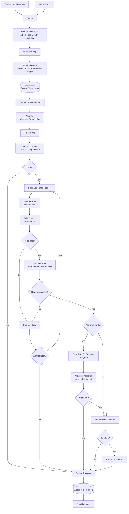

# PlacidWay → Facebook: daily content automation

One fresh, on-brand Facebook post per day, built from publicly available
PlacidWay pages, with a guardrail that is willing to throw the post away.

Built for the AI Automation Engineer take-home. Platform: **n8n**.

---

## Contents

- [What it does](#what-it-does)
- [Architecture](#architecture)
- [Quick start](#quick-start)
- [Setup](#setup)
- [Environment variables](#environment-variables)
- [Running it](#running-it)
- [The guardrail](#the-guardrail)
- [Design decisions](#design-decisions)
- [Failure handling](#failure-handling)
- [Repository layout](#repository-layout)
- [Known limits](#known-limits)

---

## What it does

Once a day the workflow picks one PlacidWay page that has never been posted,
extracts its real content, asks an LLM to write a Facebook post from that
content and nothing else, checks the result twice, optionally routes it to a
human, and publishes it to a **test Page** — or simulates the publish, which is
the default.

Every run is written to a Google Sheet whether it succeeded, was rejected, or
crashed. The sheet is both the deduplication store and the audit trail.

| Requirement | Where it lives |
|---|---|
| Daily schedule + manual run | `Daily Schedule` (cron `0 7 * * *`) and `Manual Run` triggers |
| Extract title, URL, summary, body, image | `Fetch Page` → `Extract Content` |
| Pick one item, never repeat a URL | `Load Posted Log` → `Choose Unposted Item` |
| LLM writes hook / value / CTA / link / hashtags, <500 chars | `Build Generator Request` → `Generate Post` |
| Guardrails against claims, invented prices, invented facts | `Rule Checks` + `Validate Post` (two layers) |
| Publish with image when one exists | `Build Publish Request` → `Post To Facebook` |
| Auto-publish vs approval mode | `PW_REVIEW_MODE`, `Approval Mode?` → `Wait For Approval` |
| Log every run | `Record Outcome` → `Append To Run Log` |
| Retry and alert on failure | Node-level retries + `placidway-error-handler.json` |
| *Stretch:* content-type variety | `Pick Content Type` rotates article/package by weekday |
| *Stretch:* image handling | PlacidWay's own `og:image` is already 1200×630 — see [Design decisions](#the-image-decision) |

---

## Architecture



36 nodes, 17 of them Code nodes. The Code nodes do not contain bespoke
copy-pasted JavaScript — see [the build step](#the-build-step).

---

## Quick start

Everything except publishing runs with no credentials at all:

```bash
npm test                      # 37 assertions over extraction + guardrails
node scripts/fetch-fixtures.mjs   # refresh fixtures from the live site
npm run dry-run -- --no-llm       # live sitemap + extraction, no API key
npm run build                     # regenerate the workflow JSON
node scripts/validate-workflow.mjs
```

With an API key, the full pipeline runs locally without n8n:

```bash
export OPENAI_API_KEY=sk-...
npm run dry-run -- --count=3
node scripts/make-samples.mjs --from=dry-run
```

---

## Setup

### 1. n8n

Self-hosted or cloud, both work. Locally:

```bash
npx n8n
```

Then set the environment from [`.env.example`](.env.example). Two are
load-bearing:

- `N8N_BLOCK_ENV_ACCESS_IN_NODE=false` — the `Config` node reads settings
  through `$env`. Without this, it falls back to its built-in defaults, which
  keep the workflow in `simulate` mode rather than failing.
- `WEBHOOK_URL` — the approval links sent to Telegram are built from
  `$execution.resumeUrl`. If n8n does not know its own public URL, the reviewer
  gets a link to `localhost`.

### 2. Import the workflows

| File | Import as |
|---|---|
| `workflow/placidway-daily-facebook.openai.json` | main workflow (OpenAI) |
| `workflow/placidway-daily-facebook.anthropic.json` | main workflow (Anthropic) — import *one* of the two |
| `workflow/placidway-error-handler.json` | error handler |

Import the error handler first, copy its workflow ID into
`PW_ERROR_WORKFLOW_ID`, then open the main workflow and confirm
**Settings → Error workflow** points at it.

> **After import, open the two Google Sheets nodes and re-pick the document and
> sheet from their dropdowns.** The export carries the right values, but n8n's
> resource-locator fields are matched against your own credential, and selecting
> them once in the UI is the only way to be sure. `scripts/validate-workflow.mjs`
> checks everything else; it cannot check this.

### 3. Google Sheet

Create one spreadsheet with two tabs.

**`runs`** — header row, exactly these columns:

```
run_id | run_at | content_type | url | title | image | extracted_by | post_text |
attempts | rule_status | rule_violations | validator_status | validator_violations |
review_mode | approval_outcome | publish_mode | fb_post_id | status | error
```

**`errors`** — header row:

```
kind | severity | nodeName | status | message | hint | executionUrl | workflowName | alertText | failedAt
```

Put the spreadsheet ID in `PW_SHEET_ID`. Credential: **Google Sheets OAuth2**,
which needs a Google Cloud project with the Sheets API enabled and
`https://<your-n8n>/rest/oauth2-credential/callback` as an authorised redirect URI.

### 4. Facebook test Page

1. Create a Page you own. **Never point this at a PlacidWay Page.**
2. At [developers.facebook.com](https://developers.facebook.com), create an app
   (type *Business*) and open the **Graph API Explorer**.
3. Request `pages_manage_posts`, `pages_read_engagement`, `pages_show_list`.
4. Generate a User token, then exchange it for a **long-lived Page token** —
   the short-lived one expires in about an hour and is the single most common
   reason a workflow like this dies three days after the demo:

   ```
   GET /oauth/access_token
       ?grant_type=fb_exchange_token
       &client_id=<APP_ID>
       &client_secret=<APP_SECRET>
       &fb_exchange_token=<SHORT_LIVED_USER_TOKEN>
   ```

   Then `GET /me/accounts` with the long-lived user token and take the Page
   token from the response. Page tokens derived this way do not expire while
   the app and permissions stay in place.
5. In n8n create a **Header Auth** credential named *Facebook Page token*:
   - Name: `Authorization`
   - Value: `Bearer <PAGE_ACCESS_TOKEN>`

   The token lives in the credential, so it never appears in the exported JSON.
6. Put the numeric Page ID in `PW_FB_PAGE_ID`.

### 5. LLM credential

**Header Auth**, matching the workflow you imported:

| Provider | Header name | Header value |
|---|---|---|
| OpenAI | `Authorization` | `Bearer sk-...` |
| Anthropic | `x-api-key` | `sk-ant-...` |

### 6. Telegram (drafts and alerts)

Create a bot with [@BotFather](https://t.me/botfather), add it to a chat, and
read the chat ID from `https://api.telegram.org/bot<TOKEN>/getUpdates`. Credential:
**Telegram API**. Set `PW_TELEGRAM_CHAT_ID`.

Only needed for `PW_REVIEW_MODE=approval` and for failure alerts. Swapping it
for email means replacing two nodes; nothing else changes.

---

## Environment variables

| Variable | Default | What it does |
|---|---|---|
| `PW_PUBLISH_MODE` | `simulate` | `simulate` \| `schedule` \| `publish` |
| `PW_REVIEW_MODE` | `approval` | `auto` \| `approval` |
| `PW_ALLOW_PRICE_MENTION` | `false` | Allow a price **only** if it matches the source exactly |
| `PW_MAX_CHARS` | `500` | Character budget before the link |
| `PW_MAX_ATTEMPTS` | `3` | Generation attempts before giving up |
| `PW_CRAWL_DELAY_SECONDS` | `3` | Honours PlacidWay's `robots.txt` |
| `PW_CANDIDATE_LIMIT` | `40` | Newest N sitemap entries considered |
| `PW_MIN_BODY_LENGTH` | `400` | Below this a page is treated as unusable |
| `PW_SCHEDULE_OFFSET_MINUTES` | `60` | How far ahead `schedule` mode posts |
| `PW_FORCE_CONTENT_TYPE` | *(empty)* | Override the weekday rotation |
| `PW_MODEL` | provider default | Model name |
| `PW_SHEET_ID` | — | Google Sheet ID |
| `PW_FB_PAGE_ID` | — | Test Page ID |
| `PW_FB_GRAPH_VERSION` | `v21.0` | Graph API version |
| `PW_TELEGRAM_CHAT_ID` | — | Reviewer / alert chat |
| `PW_ERROR_WORKFLOW_ID` | — | Imported error handler |
| `PW_USER_AGENT` | `PlacidWayContentBot/1.0` | Sent on every request |

---

## Running it

**Manual test run.** Open the workflow, click *Execute Workflow*. With defaults
(`simulate` + `approval`) it builds the post, runs both guardrail layers, sends
the draft to Telegram, and waits. Approving writes a `simulated` row; nothing
reaches Facebook.

**Scheduled.** Activate the workflow. It fires at 07:00 in the workflow's
timezone.

**Going live.** Set `PW_PUBLISH_MODE=publish` once you have watched a few
simulated runs and are happy with the copy.

**Iterating on prompts.** Do not do it in n8n. Edit `prompts/*.md`, then:

```bash
npm run dry-run -- --type=package --count=2
```

Seconds instead of minutes, no scheduler, no credentials beyond the API key.
When the prompt is right, `npm run build` and re-import.

---

## The guardrail

The brief asks the post not to make medical claims, promise outcomes, invent
prices, or state facts not on the source page. Two layers, because they fail
differently.

### Layer 1 — deterministic rules (`lib/guardrails.js`)

Cheap, reproducible, and it fails closed. It checks:

- **Length** before the link, and a floor so a one-liner cannot slip through
- **Hashtags**: 3–5, no duplicates
- **Links**: the exact source URL present, and no other link
- **Prohibited claims**: 14 patterns covering cures, guarantees, risk-free and
  pain-free promises, superlatives, instant results, individual medical advice
- **Price policy**: see below
- **Numeric grounding**: *every figure in the copy must appear in the source page*

That last check is the one that earns its keep. Hallucinated statistics are the
most likely and most damaging failure mode here, and they are trivially
detectable: pull every number out of the post, pull every number out of the
source, and demand the first set be a subset of the second. Integers ≤ 10 are
exempt — "3 clinics", "2 weeks" are ordinary prose and demanding exact matches
on them generates false alarms.

Note what is **not** banned: "cost", "success rate", "treatment", "recovery".
PlacidWay's own article titles contain them — *"IVF in Mexico vs USA: Cost &
Success Rates"* — so banning the topic word would reject accurate posts. The
rules ban the *claim*, not the *subject*. There is a test for exactly this.

Hashtags and the URL are stripped before claim matching, so `#CancerCare`
cannot trip the disease patterns and a URL slug is never read as editorial copy.

### Layer 2 — an independent reviewer (`prompts/validator.md`)

A second LLM call at temperature 0 that sees **only the source page and the
finished post**. It never sees the generator's reasoning or its
`grounding_notes`; showing it the author's own justification turns an
independent check into a rubber stamp.

It checks seven rules (grounding, medical claims, numbers, superlatives,
advice, attribution, link) and is told explicitly: *if you are unsure whether
something is supported by the source, fail it.* Regenerating a post is cheap.
Publishing a medical claim is not.

The verdict parser fails closed — unparseable output is a `FAIL`, never a pass.

### The retry loop

A rejection from either layer is not the end. `Prepare Retry` feeds the
**specific violations** back into the generator prompt and asks again, up to
`PW_MAX_ATTEMPTS`. A model told exactly which line broke which rule fixes it; a
blind retry at a higher temperature tends to reproduce the same mistake.

After the last attempt the run is logged with `status=rejected` and the full
reason. Nothing is published. A silent day is a better outcome than a bad post.

### The price decision

Package pages publish a real, structured price:

```json
"offers": { "@type": "Offer", "priceCurrency": "USD", "price": "16000.0" }
```

So "never mention a price" would be throwing away accurate information, and
"mention prices freely" invites exactly the failure the brief warns about.
Instead there are three states, and the code keeps them distinct:

| Source page | `PW_ALLOW_PRICE_MENTION` | Behaviour |
|---|---|---|
| no price | either | any currency figure is a hard rejection |
| has price | `false` *(default)* | any currency figure is a hard rejection |
| has price | `true` | a figure is allowed **only if it equals `offers.price` exactly** |

`"$16,000"`, `"16000.0"` and `"16,000 USD"` all normalise to the same number
before comparison. The default is off because prices change and an evergreen
social post does not.

---

## Design decisions

### Why sitemap parsing, not a headless browser

PlacidWay publishes a sitemap index with 71 child sitemaps. The article sitemap
gives us, per entry, the URL, a `lastmod` date, **and** the featured image:

```xml
<url>
  <loc>https://www.placidway.com/article/5596/IVF-in-Mexico-vs-USA...</loc>
  <lastmod>2026-11-09</lastmod>
  <image:image><image:loc>https://placidwaycdn.s3.amazonaws.com/...</image:loc></image:image>
</url>
```

Which means a complete run costs **two HTTP requests**: one sitemap, one page.
A headless browser would cost a Chromium process and several seconds per page
to recover information that is already sitting in XML. The pages are
server-rendered, so there is no JavaScript to execute. Puppeteer here would be
a cost with no corresponding benefit.

### Why JSON-LD, not CSS selectors

Every PlacidWay page carries schema.org structured data. Articles expose
`Article.articleBody` — the full text, 22 kB on a typical piece. Packages expose
`Product` with `offers`, `brand` and `aggregateRating`.

Structured data is machine-authored and changes far more slowly than markup. A
redesign that moves `div.article-content` will usually leave the JSON-LD intact,
and `extractedBy` is written to every log row, so a silent fallback to Open
Graph shows up in the sheet before it shows up in the output quality.

There are three tiers, tried in order:

1. **JSON-LD** — `Article.articleBody`, or `Product` + `offers`
2. **Open Graph** — present on every page, survives template churn
3. **`.pack-inner-content`** — body text only, last resort

Package pages have no `articleBody`, so they genuinely exercise tier 3; it
recovers ~12.8 kB of text on the mastectomy fixture.

### Respecting the site

The brief says no more than one request per second. `robots.txt` says
`Crawl-delay: 3`. **The stricter number wins** — `Respect Crawl Delay` waits 3
seconds, and the dry-run harness does the same. We also send a descriptive
`User-Agent` with a contact point rather than pretending to be a browser.

Worth noting: PlacidWay's `robots.txt` explicitly `Allow: /` for `GPTBot`,
`ClaudeBot` and `PerplexityBot`, and explicitly allows `/cdn-cgi/image/*`,
which is the path the featured images are served from.

### The image decision

The stretch goal suggests resizing or branding the featured image. PlacidWay's
`og:image` is already served through Cloudflare's image resizer at exactly
**1200×630**:

```
/cdn-cgi/image/quality=85,fit=pad,width=1200,height=630/...
```

That is Facebook's recommended ratio. Re-encoding it would cost a round trip
and lose quality to recompression, to arrive at the same dimensions. So the
workflow uses the URL directly, and `Build Publish Request` routes on presence:

- image present → `POST /{page}/photos` with `url` + `caption`
- no image → `POST /{page}/feed` with `message` + `link`, so Facebook renders
  its own link card

*Trade-off:* a photo post shows the link as plain text in the caption rather
than as a rich card. Photo posts generally earn more reach, so that is the
default when an image exists — but it is one line to change in
`Build Publish Request` if the engagement data says otherwise.

### Why Google Sheets

Not because it scales. Because a reviewer can open it.

It is the deduplication store *and* the run log *and* the thing you point a
camera at during a walkthrough. For production this is a Postgres table — the
schema is already relational and `Choose Unposted Item` would become a single
indexed `NOT EXISTS` query instead of reading every row. At one post per day,
reading every row stays comfortable for years, and the visibility is worth more
right now than the efficiency.

Rows with `status` of `failed`, `rejected` or `expired` are deliberately **not**
treated as used, so a transient outage does not silently burn a piece of content.

### The build step

n8n Code nodes cannot import files. The usual consequence is that the
interesting logic gets pasted into the canvas, and the copy in version control
drifts away from the copy that actually runs within a week.

So `scripts/build-workflow.mjs` compiles the workflow instead: it reads
`lib/extract.js`, `lib/guardrails.js` and `lib/compose.js`, strips the ESM
keywords, and inlines them into the Code nodes that need them. The same
functions are imported directly by `scripts/dry-run.mjs` and exercised by
`npm test`.

The consequence worth stating: **the code covered by those 37 assertions is
byte-for-byte the code running at 07:00.** Editing the workflow in the n8n UI
and exporting over these files would break that, which is why the JSON files
carry a `meta.note` saying so.

`scripts/validate-workflow.mjs` then checks the compiled output: every
connection resolves, no node is orphaned, every Code node's JavaScript parses,
every `$('Node Name')` reference names a real node, and every expression has
balanced `{{ }}`.

### Variety

`Pick Content Type` rotates by weekday — articles Sun/Mon/Wed/Fri, packages
Tue/Thu/Sat — so the Page does not read as four identical article links in a
row. Only the two sitemaps whose page structure has actually been verified are
in the rotation; adding `answers` or `news` means verifying their JSON-LD
first, which is a twenty-minute job, not a guess.

---

## Failure handling

Three layers, because they catch different things.

**Node level.** `Fetch Sitemap`, `Fetch Page`, `Generate Post` and
`Validate Post` retry 3× with a 5 s backoff. `Post To Facebook` retries twice
with 10 s, deliberately fewer — a failed publish that half-succeeded is worse
than a missed day.

**Guardrail level.** A rejected post is not an error. It is retried with
feedback, and if it still fails, logged as `rejected` and dropped.

**Workflow level.** `placidway-error-handler.json` runs on any unhandled
throw. It classifies the failure before alerting, because a 500 from PlacidWay
and an expired token need different responses:

| Class | Severity | Typical cause |
|---|---|---|
| `AUTH` | page | Token expired or revoked — the daily run is blocked |
| `RATE_LIMIT` | warn | Throttled; usually self-correcting |
| `UPSTREAM_5XX` | warn | Site or API down after our retries |
| `NETWORK` | warn | DNS/socket failure |
| `CONTENT_EXHAUSTED` | warn | Everything recent has been posted |
| `EXTRACTION` | page | Sitemap shape changed — re-run the fixtures |
| `UNCLASSIFIED` | page | Unseen failure mode |

The alert carries the class, the failing node, the error, a link to the
execution, and a sentence on what to do. Both the Telegram node and the Sheets
node use `continueRegularOutput`, so a Telegram outage still gets the failure
into the sheet.

The failure mode this is mostly built for is the Facebook token. Short-lived
tokens expire in about an hour; even long-lived Page tokens can be invalidated
by a password change or a permissions review. When that happens the alert says
`AUTH`, not `HTTP 400`.

---

## Repository layout

```
├── lib/                      tested logic, inlined into the workflow at build time
│   ├── extract.js            sitemap parsing, JSON-LD / og: extraction
│   ├── guardrails.js         rule-based checks, verdict parsing
│   └── compose.js            prompt assembly, provider plumbing
├── prompts/
│   ├── generator.md          writes the post
│   └── validator.md          independent reviewer (guardrail layer 2)
├── scripts/
│   ├── build-workflow.mjs    compiles the main workflow
│   ├── build-error-workflow.mjs
│   ├── validate-workflow.mjs structural checks on the compiled JSON
│   ├── test-guardrails.mjs   37 assertions, no framework, no install
│   ├── dry-run.mjs           full pipeline locally, without n8n
│   ├── fetch-fixtures.mjs    refresh fixtures from the live site
│   └── make-samples.mjs      builds samples/sample-posts.md
├── workflow/                 GENERATED — do not hand-edit
│   ├── placidway-daily-facebook.openai.json
│   ├── placidway-daily-facebook.anthropic.json
│   └── placidway-error-handler.json
└── samples/
    ├── sample-posts.md       the sample-output deliverable
    ├── reference-posts.json  drafts used to exercise the guardrails
    └── fixtures/             real pages, used by the tests
```

---

## Known limits

Stated plainly, because they are the interesting part of the conversation.

- **Google Sheets will not scale.** Every run reads the whole sheet. Fine at one
  post per day for years; wrong at a hundred. Postgres is the answer and the
  schema is already shaped for it.
- **The 40-entry candidate window is arbitrary.** If PlacidWay publishes faster
  than we post, older unposted items fall out of the window permanently. A real
  fix walks the sitemap from the oldest unposted item rather than the newest.
- **Numeric grounding is subset matching, not semantics.** A post saying
  "7 days" where the source says "7–14 days of outpatient drain management" is
  technically grounded and arguably misleading. Layer 2 is what catches that,
  and layer 2 is a language model, so it is not a guarantee.
- **No engagement read-back.** The stretch goal for storing reactions and clicks
  next to each post is not implemented. The sheet has room for it and
  `fb_post_id` is already recorded, so it is a second scheduled workflow
  reading `/{post-id}/insights`, not a redesign.
- **The approval webhook has no authentication.** Anyone holding the resume URL
  can approve a post. For a demo on a private n8n that is acceptable; for
  production the link needs a signed token.
- **Credential-bound node parameters are not statically verifiable.** The
  validator proves the graph is sound. It cannot prove your Google Sheets
  resource locators resolve — see the note in [Setup](#2-import-the-workflows).
- **One LLM provider per import.** Swapping means rebuilding with
  `--provider=` and re-importing, rather than flipping an environment variable.
  That was a deliberate trade: a runtime switch would have put provider
  branching inside expressions, which is the thing this design is most trying
  to avoid.
